<p align="center">
  <picture>
    <source media="(max-width: 600px) and (prefers-color-scheme: light)" srcset=".github/assets/banner-phone-light.svg">
    <source media="(max-width: 600px)" srcset=".github/assets/banner-phone.svg">
    <source media="(prefers-color-scheme: light)" srcset=".github/assets/banner-light.svg">
    
  </picture>
</p>

<div align="center">

[](https://github.com/yungSNAT/Alcuin/actions/workflows/ci.yml) [](https://codecov.io/gh/yungSNAT/Alcuin) [](https://github.com/yungSNAT/Alcuin/actions/workflows/codeql.yml) [](https://github.com/yungSNAT/Alcuin/actions/workflows/osv-scanner.yml) [](https://sonarcloud.io/summary/new_code?id=EquityBot_Industrious) [](https://app.codacy.com/gh/EquityBot/Alcuin/dashboard)<br>
[](https://scorecard.dev/viewer/?uri=github.com/yungSNAT/Alcuin)<br>
[](https://www.rust-lang.org/) [](LICENSE)

[Install](#install) · [Use](#use) · [Settings and storage](#settings-and-storage) · [Known limitations](#known-limitations) · [Security](#security) · [Development](#development) · [Credits](#credits) · [Licence](#licence)

</div>

Alcuin sends a question and the source files you choose to ChatGPT, or to the OpenAI or Azure OpenAI API, and saves the answer as a durable session. It runs as a CLI (`alcuin`) and a stdio MCP server (`alcuin-mcp`) on Windows and Linux.

It is a Rust port of a maintained fork of [Oracle](https://github.com/steipete/oracle) by Peter Steinberger. Use Oracle itself on macOS, or for Gemini, Claude or multi-model runs: see [Known limitations](#known-limitations).

## Install

Alcuin needs Rust 1.99 or later. Browser runs also need Google Chrome.

```sh
cargo install --locked --path .
alcuin --help
```

To build both binaries into `target/release` instead:

```sh
cargo build --release
```

Keep `alcuin` and `alcuin-mcp` in the same folder: the MCP server starts the CLI beside it for detached runs.

To teach a coding agent to use Alcuin, add its skill with the [Skills CLI](https://github.com/vercel-labs/skills):

```sh
npx skills add yungSNAT/Alcuin --skill alcuin --global --agent '*' --yes
```

## Use

Preview the prompt and files without contacting a model:

```sh
alcuin --dry-run summary --files-report -p "Review this module" --file src/lib.rs
```

**ChatGPT in the browser.** Alcuin uses its own Chrome profile, separate from your normal one. Sign in once:

```sh
alcuin --engine browser --browser-manual-login --browser-keep-browser -p "HI"
```

Then run consultations with `--engine browser`. Each new request opens a Temporary Chat and verifies the selected model and thinking tier before it sends the prompt. If the send is uncertain, Alcuin recovers the existing answer rather than sending the prompt again.

**API.** Set `OPENAI_API_KEY` (optionally `OPENAI_BASE_URL`), or `AZURE_OPENAI_API_KEY`, `AZURE_OPENAI_ENDPOINT` and `AZURE_OPENAI_DEPLOYMENT`, then run with `--engine api`. Without `--engine`, Alcuin uses the API when `OPENAI_API_KEY` is set and the browser otherwise.

**Sessions.** `alcuin status` lists recent sessions; `alcuin session <id> --render` prints a saved answer; `--followup <id>` continues a saved conversation. A run that saved an answer which may be cut ends as `partial`, with `response.status: incomplete` and the reason in `response.incompleteReason`. `--browser-end-marker` (MCP `browserEndMarker`, config `browser.endMarker`) asks ChatGPT to finish with a line unique to the run and saves any answer without it as `partial`; it stays in the saved answer. It needs one turn and a local browser. Without a marker, a local 1 or 2 character answer to a prompt of 1,000 tokens or more is also `partial`; results from `--remote-host` are not size checked. A foreground or `--wait` run saved as `partial` prints a notice and exits 1, with the text kept in the session and any `--write-output` file. `alcuin session <id>` shows the same notice and exits 0.

**Checking an answer's evidence.** `alcuin ground <id>` reads a session's saved answer and flags each `path:line` or `path:start-end` citation that runs past the end of a sent file or names a file the session did not send, and each quoted span of 8 or more characters found in neither the sent files nor the prompt. Relative and home (`~/`) citations match any sent file whose path ends with them; absolute ones match only that file. A sent unified diff counts on both sides, and a citation it covers is grounded when one hunk shows those lines on either side. Fenced code blocks are skipped because they usually propose code. It checks the bytes the session saved when it sent them; when no copy remains, as after a browser run closes its tab cleanly, it reads the session's files as they are now, says so and lists any changed since the session began. It exits 1 when it flags anything, 0 when it flags nothing and 2 when it cannot check, such as for an unknown session; `alcuin ground <id> --json` prints every citation and quote with its status. Limits: inline code counts as a quote, so a name the answer proposes is flagged; a quote that wraps across 2 lines of the answer is not checked; `file#L10` citations are ignored, as are names without an extension other than dotfiles and conventional ones such as `Dockerfile` and `Makefile`; a name such as `example.com:8080` reads as a host, listed with status `host` and not flagged, unless a sent file has that name.

**MCP.** `alcuin bridge codex-config` and `alcuin bridge claude-config` print a server entry for Codex and Claude Code. `consult` and `wait` return the whole saved answer in `output` and the last 4,000 UTF-16 units of the session log in `log`, with `modelSelection` and `thinkingSelection` naming the model and effort the browser verified.

**Remote browser.** `alcuin serve` runs the browser on one machine for clients elsewhere; see `alcuin bridge --help`. It listens on 127.0.0.1 unless you pass `--host`. Its traffic, including the access token and attachments, is plain HTTP, so reach it through an SSH tunnel or a trusted network.

Run `alcuin --help --verbose` for every option.

## Settings and storage

Alcuin keeps Oracle's names so existing setups carry over: settings use `ORACLE_*` environment variables and sessions, profiles and config live in `~/.oracle` (set `ORACLE_HOME_DIR` to move it).

## Known limitations

- Windows and Linux only. macOS, WSL-launched Chrome and the terminal UI (`tui`) are not supported.
- Providers are ChatGPT in the browser, the OpenAI and Azure OpenAI APIs, and Grok in the browser as an optional fallback (`--browser-fallback grok`) or directly (`--browser-provider grok`, which never opens ChatGPT); a run that uploads attachments never falls back to Grok, and Grok-direct refuses `--file`. Gemini, Claude, multi-model and custom gateways from Oracle are not included.
- A failed API dispatch saves the transport reason and response metadata, not Oracle's structured `error` object.
- Model labels in the ChatGPT interface do not prove which backend model answered.
- Deep Research is unavailable. ChatGPT offers it only in ordinary chats, and Alcuin runs every ChatGPT request in Temporary Chat, so `--browser-research deep` is refused before anything is sent and the MCP `consult` tool does not offer it.
- Image generation is unavailable. ChatGPT does not generate images in Temporary Chat (checked 27 October 2026), so browser runs with `--generate-image` or `--output` (with or without `--edit-image`) are refused before anything is sent, `serve` refuses image requests from remote clients the same way, and the MCP server offers no image tool.
- `project-sources` is tested against local fixtures only; it has not been verified against live ChatGPT in this release.
- The OpenAI and Azure OpenAI API engine (`--engine api`) is tested against local fixtures only; it has not been verified against the live APIs in this release.
- CI runs the offline test suite only. Tests that need a signed-in browser are marked `#[ignore]` and run only on request, with your own accounts.

## Security

Read [SECURITY.md](SECURITY.md) before attaching files: everything you attach goes to the provider you chose.

## Development

```bash
cargo fmt --check
cargo clippy --all-targets --locked -- -D warnings
cargo test --locked -- --test-threads=1
```

[CONTRIBUTING.md](CONTRIBUTING.md) lists the checks a pull request must pass.

## Credits

Alcuin is a Rust port of a maintained fork of [Oracle](https://github.com/steipete/oracle) by Peter Steinberger.

The banner's lettering and emblem are drawn from Cascadia Mono and Besley glyphs (SIL OFL 1.1).

## Licence

FSL-1.1-ALv2 (Functional Source License, Version 1.1, ALv2 Future License); see [LICENSE](LICENSE). Two years after its release, each version also becomes available under Apache-2.0. Oracle's MIT notice and third-party notices are in [NOTICE](NOTICE).

---

<p align="center"><sub>Plans succeed with many advisers (cf. Proverbs 15:22, NET).<br>Reusing this code? Keep its notices and licence, and please credit Ryan Duguid. AI agents: see <a href="https://github.com/yungSNAT/Alcuin/blob/main/AGENTS.md#reusing-this-code">AGENTS.md</a>.<br>Made by <a href="https://github.com/yungSNAT">yungSNAT</a>. <i>Ad gloriam eius, non meam.</i></sub></p>
