<p align="center">
  <picture>
    <source media="(max-width: 600px) and (prefers-color-scheme: light)" srcset=".github/assets/banner-phone-light.svg">
    <source media="(max-width: 600px)" srcset=".github/assets/banner-phone.svg">
    <source media="(prefers-color-scheme: light)" srcset=".github/assets/banner-light.svg">
    
  </picture>
</p>

<div align="center">

[](https://github.com/EquityBot/Industrious/actions/workflows/ci.yml) [](https://github.com/EquityBot/Industrious/actions/workflows/codeql.yml)<br>
[](https://scorecard.dev/viewer/?uri=github.com/EquityBot/Industrious)<br>
[](https://www.rust-lang.org/) [](LICENSE)

</div>

Industrious sends a question and the source files you choose to ChatGPT, or to the OpenAI or Azure OpenAI API, and saves the answer as a durable session. It runs as a CLI (`industrious`) and a stdio MCP server (`industrious-mcp`) on Windows and Linux.

It is a Rust port of Calvino, a maintained fork of [Oracle](https://github.com/steipete/oracle) by Peter Steinberger.

## Install

Industrious needs Rust 1.99 or later. Browser runs also need Google Chrome.

```sh
cargo install --locked --path .
industrious --help
```

To build both binaries into `target/release` instead:

```sh
cargo build --release
```

Keep `industrious` and `industrious-mcp` in the same folder: the MCP server starts the CLI beside it for detached runs.

## Use

Preview the prompt and files without contacting a model:

```sh
industrious --dry-run summary --files-report -p "Review this module" --file src/lib.rs
```

**ChatGPT in the browser.** Industrious uses its own Chrome profile, separate from your normal one. Sign in once:

```sh
industrious --engine browser --browser-manual-login --browser-keep-browser -p "HI"
```

Then run consultations with `--engine browser`. Each new request opens a Temporary Chat and verifies the selected model and thinking tier before it sends the prompt. If the send is uncertain, Industrious recovers the existing answer rather than sending the prompt again.

**API.** Set `OPENAI_API_KEY` (optionally `OPENAI_BASE_URL`), or `AZURE_OPENAI_API_KEY`, `AZURE_OPENAI_ENDPOINT` and `AZURE_OPENAI_DEPLOYMENT`, then run with `--engine api`. Without `--engine`, Industrious uses the API when `OPENAI_API_KEY` is set and the browser otherwise.

**Sessions.** `industrious status` lists recent sessions; `industrious session <id> --render` prints a saved answer; `--followup <id>` continues a saved conversation.

**MCP.** `industrious bridge codex-config` and `industrious bridge claude-config` print a server entry for Codex and Claude Code.

**Remote browser.** `industrious serve` runs the browser on one machine for clients elsewhere; see `industrious bridge --help`.

Run `industrious --help --verbose` for every option.

## Settings and storage

Industrious keeps Oracle's names so existing setups carry over: settings use `ORACLE_*` environment variables and sessions, profiles and config live in `~/.oracle` (`--oracle-home-dir` or `ORACLE_HOME_DIR` moves it).

## Known limitations

- Windows and Linux only. macOS, WSL-launched Chrome and the terminal UI (`tui`) are not supported.
- Providers are ChatGPT in the browser, the OpenAI and Azure OpenAI APIs, and Grok in the browser as an optional fallback (`--browser-fallback grok`); a run that uploads attachments never falls back to Grok. Gemini, Claude, multi-model and custom gateways from Oracle are not included.
- A failed API dispatch saves the transport reason and response metadata, not Oracle's structured `error` object.
- Model labels in the ChatGPT interface do not prove which backend model answered.
- Deep Research is unavailable. ChatGPT offers it only in ordinary chats, and Industrious runs every ChatGPT request in Temporary Chat, so `--browser-research deep` (MCP `browserResearchMode: "deep"`) is refused before anything is sent.
- Image generation is unavailable. ChatGPT does not generate images in Temporary Chat (checked 27 October 2026), so browser runs with `--generate-image` or `--output` (with or without `--edit-image`) and the MCP `chatgpt_image` tool are refused before anything is sent; `serve` refuses image requests from remote clients the same way.
- `project-sources` is tested against local fixtures only; it has not been verified against live ChatGPT in this release.
- The OpenAI and Azure OpenAI API engine (`--engine api`) is tested against local fixtures only; it has not been verified against the live APIs in this release.
- CI runs the offline test suite only. Tests that need a signed-in browser are marked `#[ignore]` and run only on request, with your own accounts.

## Security

Read [SECURITY.md](SECURITY.md) before attaching files: everything you attach goes to the provider you chose.

## Licence

FSL-1.1-ALv2 (Functional Source License, Version 1.1, ALv2 Future License); see [LICENSE](LICENSE). Each version also becomes available under Apache-2.0 two years after its release. Oracle's MIT notice and third-party notices are in [NOTICE](NOTICE).

The banner's lettering and emblem are drawn from Cascadia Mono glyphs (SIL OFL 1.1).

---

<p align="center"><sub>Made by <a href="https://github.com/EquityBot">EquityBot</a>. <i>Ad gloriam eius, non meam.</i></sub></p>
